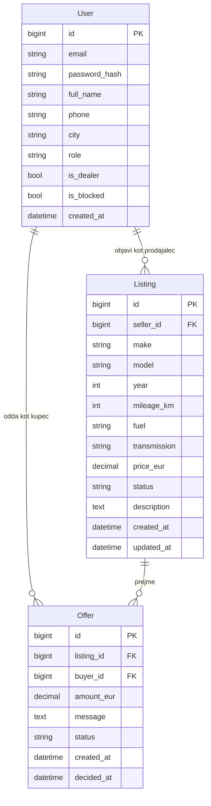

# 03 – Podatkovni model

## Pregled

Podatkovni model AvtoTrga sestavljajo 3 med seboj povezane entitete: `User`, `Listing` in `Offer`. Vse entitete so shranjene v podatkovni bazi PostgreSQL in dostopane prek SQLAlchemy ORM.

## Entitete in glavna polja

### User

Predstavlja vsakega uporabnika sistema – kupca, prodajalca ali administratorja. Vloga je določena s poljem `role`.

- `id` – primarni ključ
- `email` – unikaten, uporablja se za prijavo
- `password_hash` – zgoščeno geslo (bcrypt prek passlib)
- `full_name` – ime in priimek (ali naziv avtohiše)
- `phone` – telefon (neobvezno)
- `city` – kraj
- `role` – `buyer`, `seller` ali `admin`
- `is_dealer` – ali gre za avtohišo (vpliva na prikaz)
- `is_blocked` – ali je račun blokiran
- `created_at` – čas registracije

### Listing

Oglas za posamezen avtomobil. Pripada natanko enemu prodajalcu.

- `id` – primarni ključ
- `seller_id` – tuji ključ na `User` (`ON DELETE CASCADE`)
- `make` – znamka
- `model` – model
- `year` – letnik (CHECK med 1950 in tekoče leto + 1)
- `mileage_km` – prevoženi kilometri (CHECK ≥ 0)
- `fuel` – `bencin`, `dizel`, `hibrid`, `električni`, `plin` (PostgreSQL ENUM)
- `transmission` – `ročni`, `avtomatski` (PostgreSQL ENUM)
- `price_eur` – cena v EUR (NUMERIC(10,2), CHECK > 0)
- `status` – `aktivni`, `rezerviran`, `prodan` ali `blokiran` (PostgreSQL ENUM)
- `description` – prost opis
- `created_at` – čas objave
- `updated_at` – čas zadnje spremembe

### Offer

Ponudba, ki jo kupec odda na posamezen oglas. Ena ponudba pripada enemu kupcu in enemu oglasu.

- `id` – primarni ključ
- `listing_id` – tuji ključ na `Listing` (`ON DELETE CASCADE`)
- `buyer_id` – tuji ključ na `User`
- `amount_eur` – ponujeni znesek (NUMERIC(10,2), CHECK > 0)
- `message` – sporočilo kupca prodajalcu
- `status` – `pending`, `accepted`, `rejected` ali `withdrawn` (PostgreSQL ENUM)
- `created_at` – čas oddaje
- `decided_at` – čas odločitve (sprejem/zavrnitev/umik); NULL, dokler je `pending`

## Povezave med entitetami

- `User` 1 : N `Listing` – prodajalec ima lahko več oglasov.
- `Listing` 1 : N `Offer` – na en oglas pride več ponudb.
- `User` 1 : N `Offer` – kupec odda lahko več ponudb (tudi na različne oglase).

Poslovno pravilo: v vsakem trenutku ima lahko posamezen oglas **največ eno `accepted` ponudbo**. Ko prodajalec eno ponudbo sprejme, sistem v isti transakciji preostale `pending` ponudbe na tem oglasu prestavi v `rejected`.

## Osnutek podatkovnega modela

## Omejitve na ravni baze

- `users.email` – UNIQUE.
- `listings.seller_id` – FOREIGN KEY → `users.id` ON DELETE CASCADE.
- `offers.listing_id` – FOREIGN KEY → `listings.id` ON DELETE CASCADE.
- `offers.buyer_id` – FOREIGN KEY → `users.id` ON DELETE RESTRICT (kupca z zgodovino ponudb se ne briše, le blokira).
- `listings.year` – CHECK BETWEEN 1950 AND (extract year from now()) + 1.
- `listings.price_eur` – CHECK > 0.
- `listings.mileage_km` – CHECK ≥ 0.
- `offers.amount_eur` – CHECK > 0.
- `offers.status` – ENUM z vrednostmi `pending|accepted|rejected|withdrawn`.
- Delni indeks `idx_listings_active` na `listings(created_at DESC) WHERE status = 'aktivni'` – pokriva najpogostejšo poizvedbo.
- Delni indeks `idx_offers_pending` na `offers(listing_id) WHERE status = 'pending'` – pokriva pregled ponudb prodajalca.

## Denar in NUMERIC

Vse cene in zneski ponudb so shranjeni kot `NUMERIC(10,2)`, ne `FLOAT`. Plavajoča vejica ne predstavlja denarja točno; pri seštevanju in primerjanju cen to povzroči napake v zaokroževanju.
