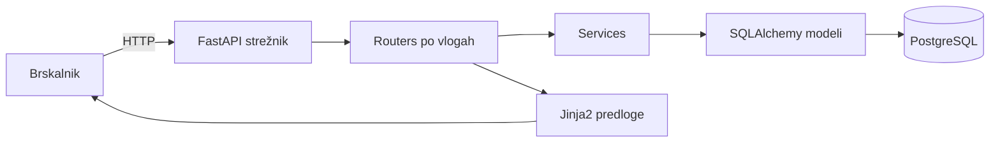

# 04 – Arhitektura in tehnološki sklad

## Arhitektura

AvtoTrg je preprosta spletna aplikacija, ki teče na enem strežniku in uporablja eno podatkovno bazo. Uporabnik do nje dostopa prek brskalnika.

### Glavni deli sistema

- **FastAPI strežnik** – sprejema zahtevke iz brskalnika in vrača HTML.
- **Routers (po vlogah)** – koda, razdeljena po vlogah: `auth`, `public`, `buyer`, `seller`, `admin`.
- **Services** – poslovna logika, npr. sprejem ponudbe z auto-reject, prehod oglasa med statusi, preverjanje blokade.
- **SQLAlchemy modeli** – entitete in poizvedbe v bazo.
- **PostgreSQL** – podatkovna baza, lokalno v Dockerju.
- **Jinja2 predloge in CSS** – izgled strani.

### Komunikacija med deli sistema

Brskalnik pošlje FastAPI strežniku HTTP zahtevek. FastAPI preveri, ali je uporabnik prijavljen (prek seje) in ali ima pravo vlogo, nato pokliče ustrezen service ali model. SQLAlchemy izvede poizvedbo v PostgreSQL, FastAPI pa vrne Jinja2 predlogo, izrisano v HTML. Brskalnik prejme HTML in ga prikaže.

### Podatkovna baza

Uporabljamo PostgreSQL 18, ki teče lokalno v Dockerju (Docker Compose). Povezava poteka prek SQLAlchemy 2.0. Shema je določena s skripto `schema.sql` (DDL z ENUM tipi, CHECK omejitvami in delnimi indeksi), testni podatki pa se naložijo s skripto `seed.py` (Faker).

### Avtentikacija in upravljanje uporabnikov

Prijava poteka s piškotki in strežniško sejo prek Starlette `SessionMiddleware`. Ob prijavi se v sejo shrani `user_id`; FastAPI dependency `current_user` ob vsakem zahtevku prebere uporabnika iz baze in preveri, ali ni blokiran. Gesla so zgoščena z bcrypt (passlib). Vsaka vloga ima svoj FastAPI router in svoje predloge. Dostop do zaščitenih poti preverjajo dependency funkcije, ki preverijo vlogo prijavljenega uporabnika.

### Način lokalnega zagona

1. Zaženemo PostgreSQL v Dockerju (`docker compose up -d`).
2. Ustvarimo Python virtualno okolje in namestimo odvisnosti (`pip install -r requirements.txt`).
3. Naložimo shemo in testne podatke (`python seed.py`).
4. Zaženemo aplikacijo (`python run.py`) in odpremo brskalnik na `http://127.0.0.1:8000`.

### Diagram

## Tehnološki sklad

- **Frontend:** Jinja2 predloge, HTML, CSS (ročno napisan, brez ogrodja).
- **Backend:** Python 3.11+, FastAPI, SQLAlchemy 2.0, Uvicorn.
- **Podatkovna baza:** PostgreSQL 18 (lokalno v Dockerju).
- **Avtentikacija:** Starlette `SessionMiddleware` (piškotki + itsdangerous), passlib[bcrypt] za zgoščevanje gesel.
- **Obrazci:** ročno branje prek `Form(...)` v FastAPI; validacija v service funkcijah.
- **Lokalni razvoj:** Docker, Docker Compose, Python virtualno okolje, `requirements.txt`.
- **Testni podatki:** Faker (sl_SI).
- **Drugo:** Mermaid za diagrame v dokumentaciji.

## Arhitekturne odločitve

- **Server-rendered monolit.** Ker je projekt majhen in ekipa ena oseba, ne uvajamo ločenega frontenda in backenda. FastAPI z Jinja2 predlogami zadošča. Glej [ADR 0001](adr/0001-use-server-rendered-monolith.md).
- **Routers po vlogah.** Koda je razdeljena po vlogah, da je pregledna in da vsak del sistema najdeš na enem mestu. Glej [ADR 0002](adr/0002-organize-code-by-role-routers.md).
- **Services za poslovno logiko.** Sprejem ponudbe z auto-reject, prehod oglasa med statusi in preverjanje blokade niso v route funkcijah, ampak v ločenih modulih. Glej [ADR 0003](adr/0003-services-layer-for-business-logic.md).
- **PostgreSQL.** Izbran zato, ker je zrela relacijska baza z odlično podporo v SQLAlchemy, ker podpira ENUM tipe, CHECK omejitve in delne indekse, in ker se enostavno zažene v Dockerju. Glej [ADR 0004](adr/0004-use-postgresql-for-persistence.md).
- **Ponudba kot prvorazredna entiteta.** Namesto prostega besedila ali klepeta je pogajanje modelirano kot `Offer` s statusi, kar omogoča avtomatsko zavrnitev ostalih ponudb ob sprejemu in sledljivo zgodovino. Glej [ADR 0005](adr/0005-offer-negotiation-workflow.md).
