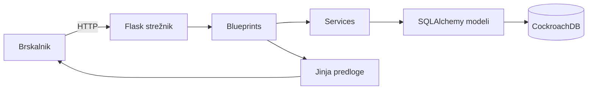

# 04 – Arhitektura in tehnološki sklad

## Arhitektura

Parkelj je preprosta spletna aplikacija, ki teče na enem strežniku in
uporablja eno podatkovno bazo. Uporabnik do nje dostopa prek
brskalnika.

### Glavni deli sistema

- **Flask strežnik** – sprejema zahtevke iz brskalnika in vrača HTML.
- **Blueprints** – koda, razdeljena po vlogah: `auth`, `driver`,
  `operator`, `admin`.
- **Services** – poslovna logika, npr. izračun parkirnine in
  preverjanje blokade računa.
- **SQLAlchemy modeli** – entitete in poizvedbe v bazo.
- **CockroachDB** – podatkovna baza, lokalno v Dockerju.
- **Jinja predloge in Bootstrap** – izgled strani.

### Komunikacija med deli sistema

Brskalnik pošlje Flask strežniku HTTP zahtevek. Flask preveri, ali je
uporabnik prijavljen in ali ima pravo vlogo, nato pokliče ustrezen
service ali model. SQLAlchemy izvede poizvedbo v CockroachDB in Flask
vrne Jinja predlogo, izrisano v HTML. Brskalnik prejme HTML in ga
prikaže.

### Podatkovna baza

Uporabljamo CockroachDB, ki teče lokalno v Dockerju kot en node.
Povezava poteka prek SQLAlchemy. Migracije skrbi Flask-Migrate.

### Avtentikacija in upravljanje uporabnikov

Prijava poteka prek Flask-Login s sejami in piškotki. Vsaka vloga (driver, operator, admin) ima svoj
blueprint in svoje predloge. Dostop do zaščitenih strani preverjajo
dekoratorji, ki preverijo vlogo prijavljenega uporabnika.

### Način lokalnega zagona

1. Zaženemo CockroachDB v Dockerju.
2. Ustvarimo Python virtualno okolje in namestimo odvisnosti.
3. Izvedemo migracije (`flask db upgrade`).
4. Zaženemo aplikacijo (`flask run`) in odpremo brskalnik.

### Diagram

Tehnološki sklad

    Frontend: Jinja predloge, HTML, CSS, Bootstrap.

    Backend: Python, Flask, SQLAlchemy, Flask-Migrate.

    Podatkovna baza: CockroachDB (lokalno v Dockerju).

    Avtentikacija: Flask-Login, Flask-WTF za obrazce in CSRF zaščito.

    Lokalni razvoj: Docker, Python virtualno okolje, requirements.txt.

    Drugo: Mermaid za diagrame v dokumentaciji.

Arhitekturne odločitve

    Server-rendered monolit. Ker je projekt majhen, ne uvajam
    ločenega frontenda in backenda. Flask z Jinja predlogami zadošča.

    Blueprints po vlogah. Koda je razdeljena po vlogah, da je
    pregledna in da vsak del sistema najdeš na enem mestu.

    Services za poslovno logiko. Izračun parkirnine in podobno ni v
    route-ih, ampak v ločenih datotekah, da se logika uporablja z več
    mest in ostane pregledna.

    CockroachDB. Izbrana zato, ker je bila že uporabljena v
    prejšnjem projektu in ker ponuja SQL bazo, ki teče lokalno v
    Dockerju, hkrati pa omogoča skalabilnost. Sam si ga želim tudi bolj podrobno spoznati.

    Simulirana rampa. Rampa je spletna stran z vnosom tablice.
    Prava strojna oprema je izven obsega, zato je dovolj simulacija
