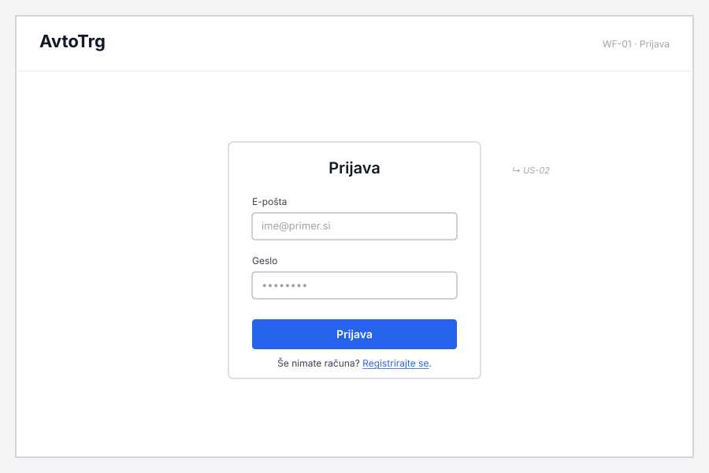

# 06 – Wireframes

Trije ključni wireframe-i MVP rešitve. Slike so v mapi `docs/wireframes/` kot `.svg` datoteke (odpirajo se v brskalniku). Izbrali smo tri zaslone, ki pokrijejo celoten ključni tok: prijavo, oddajo ponudbe s strani kupca in sprejem/zavrnitev ponudbe s strani prodajalca.

## WF-01 — Prijava

**Kaj prikazuje:**

- Zgoraj logotip in ime AvtoTrg.
- Osrednja kartica z obrazcem: e-pošta in geslo.
- Gumb "Prijava".
- Povezava "Še nimate računa? Registrirajte se." (vodi na obrazec za registracijo).

**Povezane zgodbe:** US-02.

**Zakaj ta zaslon:** prikazuje vstopno točko v sistem in osnovno avtentikacijo, ki je pogoj za vse nadaljnje role-specifične poglede.

---

## WF-02 — Detajl oglasa z obrazcem za ponudbo

**Kaj prikazuje:**

- Vrh: navigacija z logotipom, povezavama "Oglasi" in "Prodajalci", imenom prijavljenega uporabnika in gumbom "Odjava".
- Povezava "← Nazaj na oglase".
- Naslov oglasa (znamka + model) in statusna značka (`aktivni` / `rezerviran` / `prodan`).
- Leva kolona: podatki o vozilu (znamka, model, letnik, kilometri, gorivo, menjalnik, opis).
- Desna kolona: cena, povezava na javni profil prodajalca in obrazec **"Oddaj ponudbo"** (znesek v EUR, sporočilo, gumb "Pošlji ponudbo").

**Povezane zgodbe:** US-05.

**Zakaj ta zaslon:** prikazuje osrednjo domensko funkcionalnost – strukturirano oddajo ponudbe. To je tisto, kar loči AvtoTrg od običajnega oglasnika s kontaktnim obrazcem.

---

## WF-03 — Prejete ponudbe (prodajalec)

**Kaj prikazuje:**

- Vrh: navigacija z logotipom, povezavama "Moji oglasi" in "Prejete ponudbe", imenom prodajalca in gumbom "Odjava".
- Kartica oglasa: znamka + model, kratek povzetek (letnik, gorivo, km, cena), statusna značka in število ponudb v čakanju.
- Tabela ponudb s stolpci: **Kupec | Znesek | Sporočilo | Čas | Status | Dejanja**.
- Za vsako `pending` ponudbo gumba **"Sprejmi"** in **"Zavrni"**.
- Spodaj informativno opozorilo: "Ob sprejemu ene ponudbe se vse ostale ponudbe na tem oglasu samodejno zavrnejo, oglas pa preide v status «rezerviran»."

**Povezane zgodbe:** US-09, US-10.

**Zakaj ta zaslon:** prikazuje najbolj netrivialen del poslovne logike – sprejem ponudbe z atomsko avtomatsko zavrnitvijo ostalih in prehod oglasa v `rezerviran`. To je srce pogajalskega toka.

