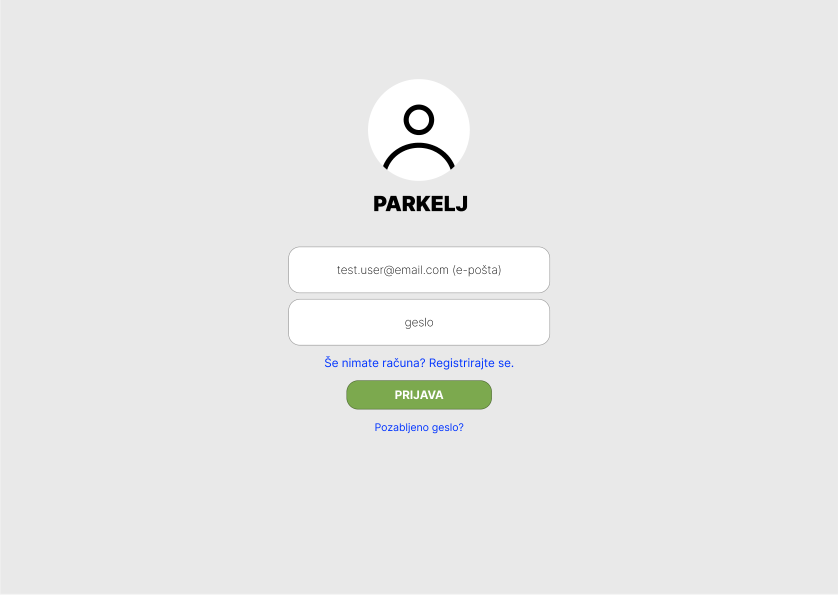
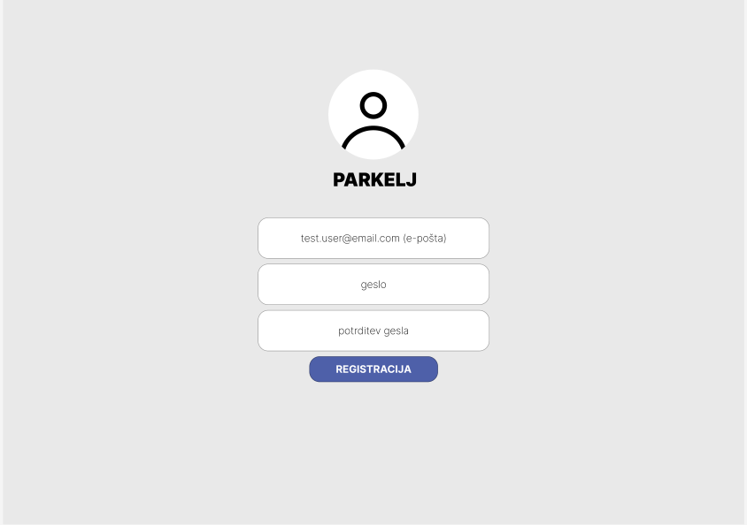
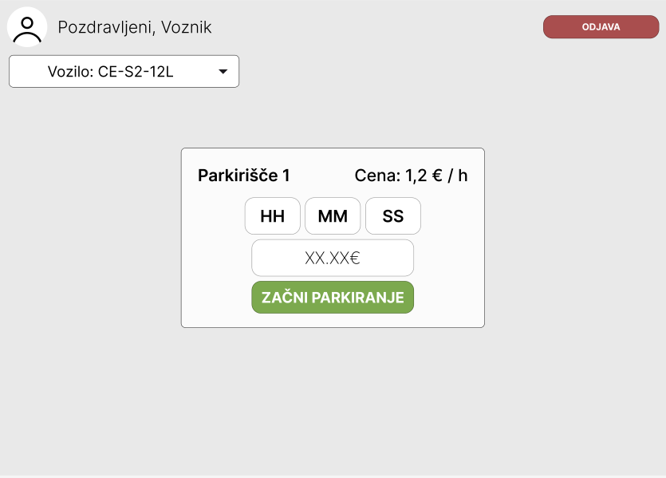

# 06 – Wireframes

Osnovni wireframe-i MVP rešitve. Slike so shranjene v mapi
`docs/wireframes/`. 

## WF-01 — Prijava

**Kaj prikazuje:**
- Zgoraj logotip in ime Parkelj.
- Obrazec z polji e-pošta in geslo.
- Gumb "Prijava".
- Povezava "Še nimate računa? Registrirajte se." (vodi na WF-02).
- Povezava "Pozabljeno geslo?".

**Povezane zgodbe:** US-02.

---

## WF-02 — Registracija

**Kaj prikazuje:**
- Zgoraj logotip in ime Parkelj.
- Obrazec s polji e-pošta, geslo in potrditev gesla.
- Pod vsakim poljem prostor za prikaz validacijskih sporočil.
- Gumb "Registracija".
- Povezava "Že imate račun? Prijavite se." (vodi na WF-01).

**Povezane zgodbe:** US-01.

---

## WF-03 — Začetek parkirne seje

**Kaj prikazuje:**
- Vrh: navigacija z logotipom, imenom voznika in gumbom "Odjava".
- Ime in naslov izbranega parkirišča ter urna cena.
- Spustni seznam za izbiro vozila (iz seznama voznikovih vozil).
- Vnos predvidenega trajanja v urah.
- Izračunan predvideni znesek, ki se posodobi sproti.
- Gumba "Začni parkiranje".

**Povezane zgodbe:** US-05, US-06.
